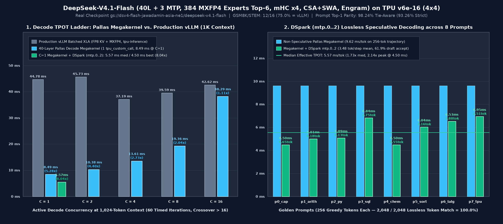

# TPU Megakernels for Kimi K3, Qwen3.8-27B (TPU v7x) & DeepSeek-V4.1-Flash (TPU v6e)

<p align="center">
  <a href="https://inferact.ai/blog/tpu-megakernels">
    
  </a>
</p>

Companion code for [700 TPS on Kimi K3: A Case for TPU Megakernels](https://inferact.ai/blog/tpu-megakernels), extended with the **DeepSeek-V4.1-Flash (`40` backbone layers + `3` `mtp.0..2` `DSpark` draft layers, `384` `MXFP4` routed experts top-6)** Pallas decode megakernel recipe for **TPU v6e-16 (Trillium)** in [`deepseek_v41/tpu-v6e/`](deepseek_v41/tpu-v6e/README.md).

This repository contains fused decode implementations for three model families across two TPU generations:

- **Kimi K3 + DSpark (`TPU v7x-32`, [`kimi/`](kimi/)):** Runs on 32 TPU v7x devices across four hosts. One megakernel executes the KDA, MLA, MoE, residual, normalization, and collective work for the target model; DSpark provides fused speculative decoding with one anchor and seven draft rows (`709 accepted tok/s`).
- **Qwen3.8-27B + DFlash2 (`TPU v7x-8`, [`qwen/`](qwen/)):** Runs on eight TPU v7x devices on one host. Its dense BF16 megakernel covers the hybrid gated-delta-net and grouped-query-attention stack, with an optional fused DFlash2 speculative-decoding loop (`1,515 accepted tok/s`).
- **DeepSeek-V4.1-Flash + DSpark (`TPU v6e-16`, [`deepseek_v41/tpu-v6e/`](deepseek_v41/tpu-v6e/README.md)):** Runs on 16 TPU v6e (Trillium) devices across four hosts (`4×4` 2D mesh). Compiles all 40 backbone layers—including Ratio-2/Ratio-1 Compressed Sparse Attention (`CSA`) with a two-level `top-512` Indexer, 128-token Sliding-Window Attention (`SWA`), route-driven top-6 of 384 `MXFP4` (`E2M1` + `UE8M0`) dynamic expert DMAs, 4-stream `mHC` hyper-connections (`20` Sinkhorn-Knopp iterations), and `203.1 GB` Host-Resident `Engram` lookups (`L1, L14`)—plus final RMSNorm and the `129,280`-vocab LM head into **a single `pallas_call` (`tpu_custom_call == 1`)**. Cuts `C = 1` TPOT at `1K` context from **`44.78 ms` (`vLLM`) down to `8.49 ms` (`5.28×` speedup)**, and with lossless `DSpark` (`mtp.0..2`, `1+4`) speculative decoding (`3.48 tok/step` mean acceptance, `2,048 / 2,048` exact token match) down to **`5.57 ms` median / `4.50 ms` best (`8.04×` median / `9.95×` peak speedup vs. `vLLM`)**.

---

## Results

### 1. TPU v7x Recipes: Kimi K3 (`32 × TPU v7x`) & Qwen3.8-27B (`8 × TPU v7x`)

With speculative decoding at an acceptance length of 6, the TPU v7x megakernels reach **709 accepted tokens per second on Kimi K3** (`16× TPU v7` vs `16× GB200`, `1.57×`) and **1,515 on Qwen3.8-27B** (`4× TPU v7` vs `4× GB200`, `2.18×`):

<p align="center">
  
</p>

<p align="center">
  
</p>

<p align="center">
  
</p>

---

### 2. TPU v6e Recipe: DeepSeek-V4.1-Flash (`40L + 3 MTP`) on `16 × TPU v6e` ([`deepseek_v41/tpu-v6e/`](deepseek_v41/tpu-v6e/README.md))

Measured on a 4-host `TPU v6e-16` (`4×4`) slice against the real checkpoint (`gs://dsv4-flash-jawadamin-asia-ne1/deepseek-v4.1-flash`):

<p align="center">
  
</p>

| Concurrency (`C`) | Production `vLLM` TPOT (`ms` / `tok/s`) | 40-Layer Pallas Megakernel (`ms` / `tok/s`) | **Megakernel + `DSpark` (`mtp.0..2`) (`Effective TPOT`)** | Speedup vs. Production `vLLM` |
|---:|---:|---:|---:|---|
| **`C = 1`** | `44.78 ms` (`22.3 tok/s`) | **`8.49 ms`** (`117.8 tok/s`) | **`5.57 ms` med / `4.50 ms` best** (`179.5–222.2 tok/s`) | **`5.28×` non-spec / `8.04×` med (`9.95×` peak) with `DSpark`** |
| **`C = 2`** | `45.73 ms` (`43.7 tok/s`) | **`10.38 ms`** (`192.6 tok/s`) | — | **`4.40×` faster than `vLLM`** |
| **`C = 4`** | `37.19 ms` (`107.6 tok/s`) | **`13.61 ms`** (`293.8 tok/s`) | — | **`2.73×` faster than `vLLM`** |
| **`C = 8`** | `39.59 ms` (`202.1 tok/s`) | **`19.36 ms`** (`413.2 tok/s`) | — | **`2.04×` faster than `vLLM`** |
| **`C = 16`** | `42.62 ms` (`375.4 tok/s`) | **`38.29 ms`** (`417.9 tok/s`) | — | **`1.11×` faster than `vLLM` (Crossover `> 16`)** |

See **[`deepseek_v41/tpu-v6e/README.md`](deepseek_v41/tpu-v6e/README.md)** and **[`deepseek_v41/tpu-v6e/TECH-NOTE.md`](deepseek_v41/tpu-v6e/TECH-NOTE.md)** for the full architecture, per-layer parity report (`min_cos = 0.999984` at `B=1`, `0.999647` at `B=8`), GSM8K/STEM accuracy (`12/16 = 75.0%`, matching `vLLM`), and `DSpark` `mtp.0..2` results (`3.48 tok/step` mean acceptance across 8 golden prompts).

---

## Setup

Create the environment from the repository root:

```bash
uv sync
```

## Verification & Benchmarks

- **DeepSeek-V4.1-Flash (`TPU v6e-16`):**
  ```bash
  # Audit saved hardware reports (< 5 seconds):
  python3 deepseek_v41/tpu-v6e/scripts/benchmark_megakernel_v6e16.py --verify-saved-reports
  # Run full 4-host hardware verification on TPU v6e-16:
  python3 deepseek_v41/tpu-v6e/scripts/benchmark_megakernel_v6e16.py --stage all
  ```
- **Kimi K3 + DSpark (`TPU v7x-32`, 4 hosts):**
  ```bash
  JOBID=<four-node-job> bash scripts/demo_kimi_dspark.sh \
    --serve 0.0.0.0:8000 --context 4096 --max-tokens 512
  ```
- **Qwen3.8-27B + DFlash2 (`TPU v7x-8`, 1 host):**
  ```bash
  JOBID=<slurm-job> bash scripts/demo_qwen_dflash.sh \
    --serve 0.0.0.0:8000 --context 2048 --max-tokens 512
  ```

## Source layout

- `deepseek_v41/tpu-v6e/`: **DeepSeek-V4.1-Flash (`40L + 3 MTP`) TPU v6e-16 (`4×4` mesh) megakernel recipe**:
  - `deepseek_v41/tpu-v6e/config.py`: Authoritative DeepSeek-V4.1-Flash architecture constants.
  - `deepseek_v41/tpu-v6e/load.py`: 48-shard GCS loader, SHA-256 verifier, and `/dev/shm` cache.
  - `deepseek_v41/tpu-v6e/engine_jax.py`: 40-layer pure-JAX reference engine (`mHC`, `CSA+SWA`, `MXFP4` MoE, `Engram`).
  - `deepseek_v41/tpu-v6e/decode_megakernel.py`: Single-`pallas_call` 40-layer decode megakernel (`tpu_custom_call == 1`) and lossless speculative verifier.
  - `deepseek_v41/tpu-v6e/dspark.py`: Real 3-layer `DSpark` (`mtp.0..2`) draft engine (`1+4` speculative loop).
  - `deepseek_v41/tpu-v6e/README.md`, `TECH-NOTE.md`, `results/`, and `scripts/`: Full documentation, hardware reports (`megakernel_v6e16_results.json`), charts, and verification scripts.
- `kimi/`: Kimi K3 (`TPU v7x-32`) target megakernel (`decode_megakernel.py`), `DSpark` (`dspark.py`), and loader (`load.py`).
- `qwen/`: Qwen3.8-27B (`TPU v7x-8`) target megakernel (`decode_megakernel.py`), `DFlash2` (`dflash.py`), and loader (`load.py`).
- `collectives16.py`, `collectives32.py`, and `pool_alias.py`: TPU collective primitives and Pallas VMEM aliasing support.

## Citation

If you use this codebase or build on our results, please cite the companion blog post:

```bibtex
@misc{novack2026tpumegakernels,
  title  = {700 TPS on Kimi K3: A Case for TPU Megakernels},
  author = {Novack, Zachary and Dao, Tri and Bick, Aviv and Gu, Albert},
  year   = {2026},
  month  = apr,
  url    = {https://inferact.ai/blog/tpu-megakernels}
}
```
